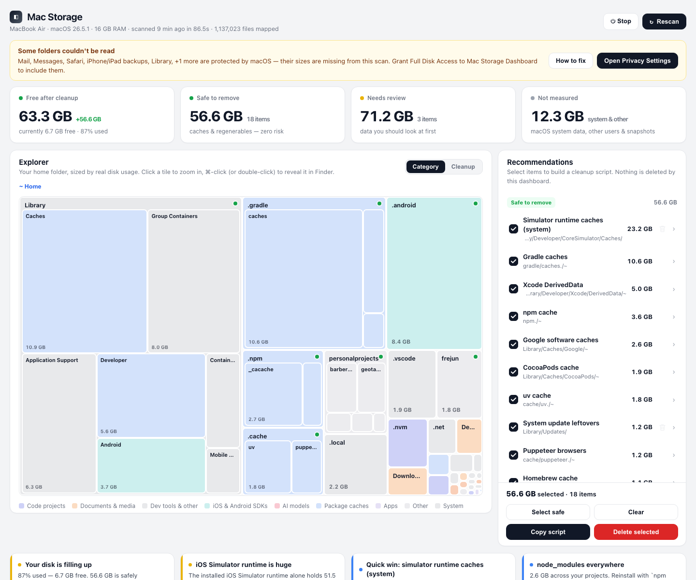
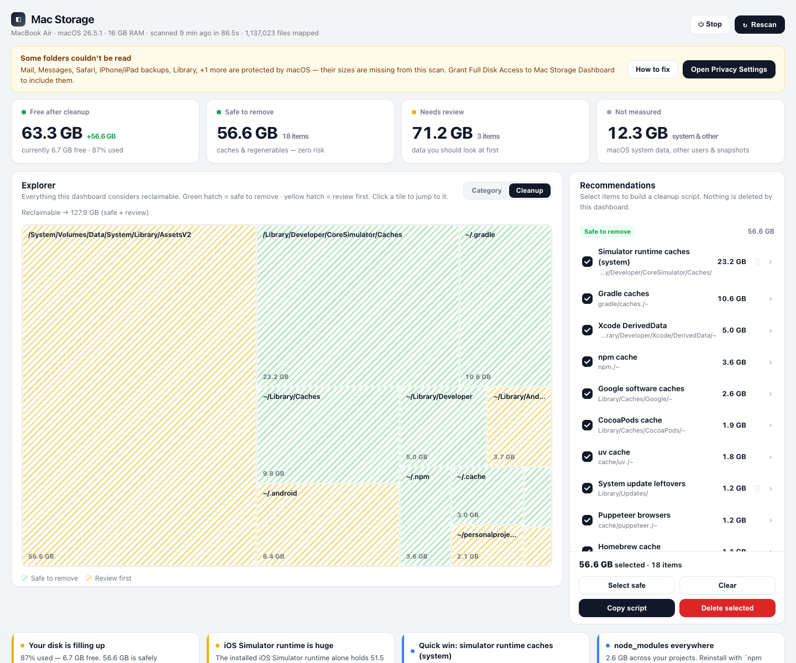
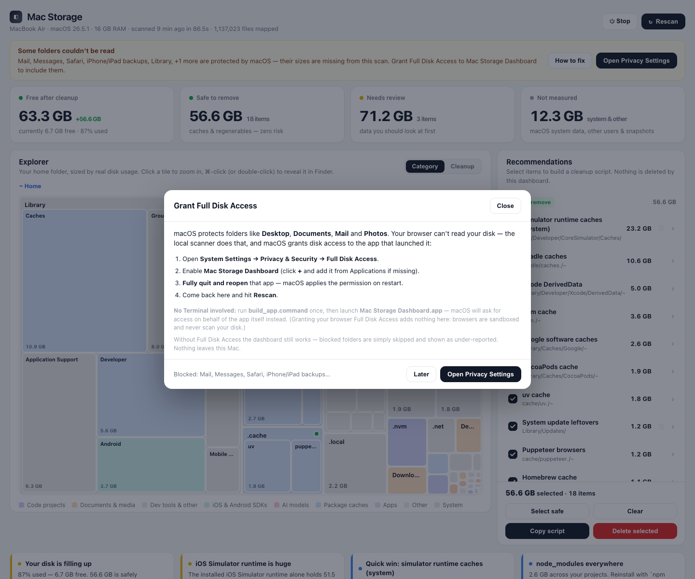
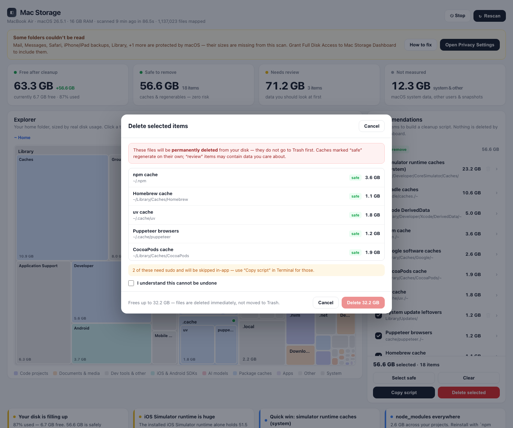

# Mac Storage Dashboard

A local, privacy-friendly dashboard that maps **your whole Mac's disk**, classifies
reclaimable space into *safe to remove* vs *review first*, and lets you clean up
**with full control** — either by copying a reviewed script, or with explicit,
confirmed deletion right in the app.



## Quick start

**Option A — Homebrew cask (recommended).** Puts the app straight into `/Applications`:

```bash
brew install --cask irfanwani/tap/mac-storage-dashboard
```

> **First launch needs your approval** — the app isn't notarized by Apple yet, so
> macOS says it "cannot verify" it. Allow it either via
> **System Settings → Privacy & Security → Open Anyway**, or in one line:
>
> ```bash
> xattr -dr com.apple.quarantine "/Applications/Mac Storage Dashboard.app"
> ```
>
> Re-apply after every `brew upgrade` — Homebrew quarantines each new download.
> Want zero approval prompts instead? Option B builds the app locally, which
> macOS never quarantines.

**Option B — PyPI (pipx).** The package builds the app for you and installs it into
`/Applications` (falls back to `~/Applications`):

```bash
brew install pipx        # if you don't have it yet
pipx install mac-storage-dashboard
mac-storage-dashboard install
```

**Option C — from source.** Clone the repo and build the app:

```bash
./build_app.command        # creates dist/Mac Storage Dashboard.app (app icon == favicon)
```

Either way you end up with **Mac Storage Dashboard** as a normal macOS app. It's
self-contained: move it anywhere, including `/Applications`. Double-click it — it
starts the dashboard server in the background and opens it in your browser, and macOS
asks that *app* for disk access instead of your terminal. Want it off? Click **⏻ Stop**
in the dashboard.

**(Releases are automated — bump `__version__`, merge to `main`, and
[the release workflow](.github/workflows/release.yml) tags, builds, publishes to
PyPI and updates the Homebrew tap. First-time setup: [RELEASING.md](RELEASING.md).)**

**Terminal alternative:** `mac-storage-dashboard run` (or, from a clone,
`python3 mac_storage_dashboard/server.py`) starts the same server and opens
http://127.0.0.1:8899. Double-clicking `run.command` does the same.

Requires macOS and Python 3.9+ (any stock Mac has it, or run `xcode-select --install`).
The first scan takes about a minute (~1M files). Nothing leaves your Mac: the server
binds to `127.0.0.1` only.

## Features

- **Explorer** — treemap of your home folder sized by real disk usage. Click a tile to
  zoom, ⌘-click (or double-click) to reveal it in Finder. The **Cleanup** tab filters
  to reclaimable space only (green = safe, yellow = review first).
- **Recommendations** — tick items to build a cleanup script (`Copy` / `Download`), or
  hit **Delete selected** to remove them in-app after a confirmation step.
- **Insights** — what's wasting space and the single command that fixes each thing.
- **Rescan** — re-maps the disk and refreshes every number.



## Permissions (Full Disk Access) — read this once

macOS protects folders like **Desktop, Documents, Mail, Messages, Safari, Photos and
iPhone backups** via privacy protection (TCC). Whatever app *launches* the scanner —
Terminal, iTerm, VS Code, or the bundled **Mac Storage Dashboard** app — needs **Full
Disk Access**, or those folders are invisible (their sizes show up as 0 / missing).

**Why not the browser?** Your browser can't scan your disk, and granting it Full Disk
Access wouldn't help — the browser is only the window. A small local scanner does the
reading, and macOS attributes the permission to the app that launched it. That's
exactly why the bundled app exists: grant access to *Mac Storage Dashboard* once and
no Terminal is involved.

This is also why tools built on `du` are quietly broken on modern macOS: `du` returns
`0` for protected folders without telling you. This dashboard instead:

- scans with a **pure-Python walker** (real sizes, one pass over ~1M files),
- **detects** protected folders it can't read and tells you exactly which ones,
- shows a banner naming the exact app to grant (the app or your terminal) plus steps.

### Grant it in 30 seconds

1. Click **Open Privacy Settings** in the dashboard banner (or open
   **System Settings → Privacy & Security → Full Disk Access**).
2. Enable the app the banner names — **Mac Storage Dashboard** if you launched the
   app, otherwise your terminal app. Add it with **+** if it's missing.
3. **Reopen** that app (the permission applies on restart).
4. Run a **Rescan**.



No banner? The scan already has full access — nothing to do.

From the terminal you can check readiness at any time:

```bash
python3 mac_storage_dashboard/scanner.py --check
```

…which prints which protected folders are readable, the app macOS will attribute the
scan to, and your disk usage. Exit code is `0` when everything is readable.

## Deleting space (how the app keeps it safe)

There are two ways to free space, and both are deliberate:

- **Copy script** — the dashboard generates `rm` commands for the items you ticked;
  nothing runs until *you* paste and execute it.
- **Delete selected** — the in-app path. The server deletes **only** the exact paths
  the scanner found for the items you ticked. Guard rails:

  - the API accepts **item IDs only**, never arbitrary paths, and re-validates every
    path against the current `data.json` before touching anything;
  - a hard-coded protection list refuses `/`, your home folder, `/Library`, `/System`,
    `/usr`, `/Applications` and friends;
  - items that need `sudo` (system caches, simulator runtimes…) are **skipped** in-app
    and flagged "use the script" instead — the dashboard never asks for your password;
  - deletion requires an explicit confirmation with an **"I understand"** checkbox;
  - deleted items are **permanently removed** (not moved to Trash) — that's the point
    of freeing disk space; the confirmation dialog says so in plain words;
  - after deleting, the dashboard **updates instantly** — the server subtracts exactly
    what was removed from the sizes, totals, treemaps and insights (no full rescan; a
    rescan only happens if that in-place update isn't possible).



When in doubt, start with the green **safe** tier — those are caches that regenerate
by themselves (npm/Homebrew/pip caches, Xcode DerivedData, simulator caches…). Yellow
**review** items are real data (iOS backups, `node_modules`, VM images, old downloads).

## What it finds

| Where | Examples |
|---|---|
| Package caches | npm, yarn, pnpm, pip, uv, Homebrew, Go, Maven, Gradle, CocoaPods, SwiftPM |
| Xcode | DerivedData, DeviceSupport, simulator caches, archives, simulators |
| System | simulator runtime caches, `/Library/Updates`, `/Library/Caches`, system assets (Siri voices, offline models) |
| Projects | `node_modules`, `.next`/`.turbo`/venv build output, `__pycache__` |
| User | Trash, old Downloads (installers), iOS backups, VMs, Ollama models, Docker |
| Android | SDK, AVD emulator images |

## CLI

Installed via pipx/PyPI:

```bash
mac-storage-dashboard run            # start the dashboard (opens in your browser)
mac-storage-dashboard app            # build "dist/Mac Storage Dashboard.app"
mac-storage-dashboard install        # build + copy the app into /Applications
mac-storage-dashboard doctor         # permission doctor (Full Disk Access readiness)
mac-storage-dashboard uninstall      # remove the app (--purge-data also erases scans)
```

From a clone (no install needed):

```bash
python3 mac_storage_dashboard/scanner.py            # scan only → data.json
python3 mac_storage_dashboard/scanner.py --check    # permission doctor
python3 mac_storage_dashboard/server.py             # dashboard + APIs on :8899
python3 mac_storage_dashboard/server.py 9000        # …on a custom port
```

## Privacy & security

- Everything runs locally; there is no telemetry, no network calls, no cloud.
- The server binds to `127.0.0.1`, checks the `Host`/`Origin` headers on every request,
  and refuses anything that isn't `localhost`.
- Scan results stay on your Mac in `data.json` — app/CLI installs keep it in
  `~/Library/Application Support/Mac Storage Dashboard/`; running the scripts from a
  clone writes it next to the code. Delete the whole `data.json` to erase scan results
  (the dashboard can regenerate it with a rescan).
- `data.json`, `scan_state.json` and `scan_log.txt` are generated files and are
  `.gitignore`d; the repo contains code only.

## Accuracy notes

- Sizes are **allocated disk blocks** (`st_blocks × 512`) — what `df` reports — with
  hard-link deduplication. Decimal units (1 GB = 1,000,000,000 bytes).
- The walker skips nothing it can read: caches, node_modules, system folders, other
  user-visible data outside your home are all included, so the numbers add up.
- Without Full Disk Access some folders are skipped — the dashboard shows you which
  ones instead of silently under-reporting.

## Files

```
mac_storage_dashboard/   the Python package
  scanner.py             single-pass disk walker → data.json (sizes, junk tiers, insights, permissions)
  server.py              localhost server (dashboard + rescan/cleanup/shutdown APIs)
  index.html             the dashboard UI (zero dependencies, works offline)
  favicon.svg            tab icon (nested treemap); rendered into the app icon at build time
  svg2png.js             build-time helper: SVG → transparent PNG (used for the app icon)
  cli.py                 mac-storage-dashboard CLI: run / app / install / doctor / uninstall
build_app.command        builds dist/Mac Storage Dashboard.app from a clone
run.command              double-click launcher (runs in Terminal)
release.command          zips the app + prints the sha256 for the Homebrew cask
packaging/homebrew/      Homebrew cask template
tests/                   sandbox integration test for the cleanup engine
docs/                    screenshots
```

## Roadmap

- Signed & notarized app bundle (so the app is trusted out of the box, no right-click-to-open).
- Scheduled scans and history graphs (snapshots are already collected in `data.json`).

## License

MIT — see [LICENSE](LICENSE).
